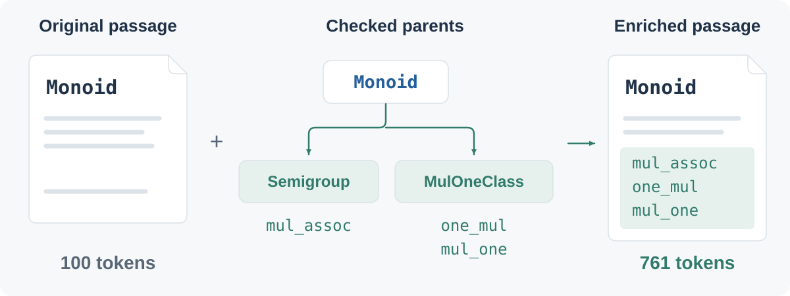
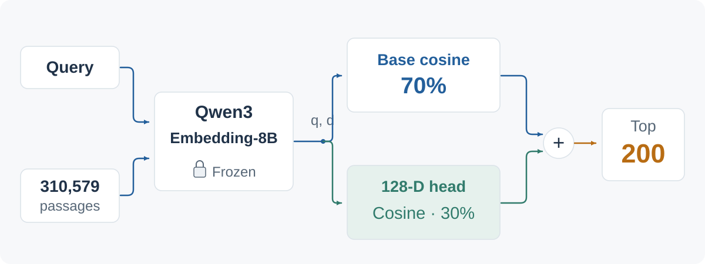
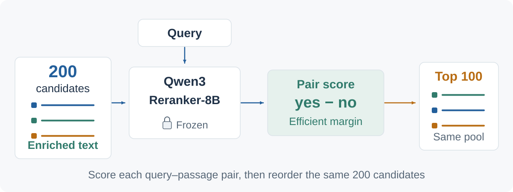
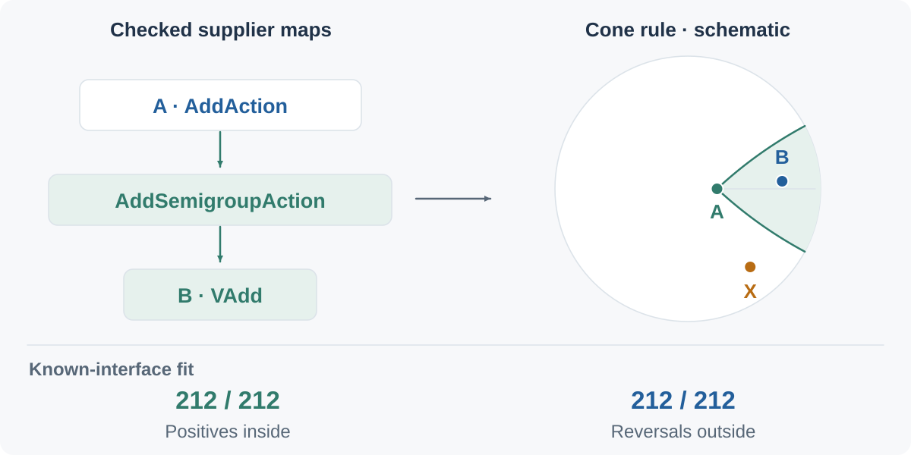

# Lean Context Search

Find Lean declarations using checked interface context, a learned embedding head, and a frozen Qwen reranker.

**Search pipeline:** enrich text → retrieve 200 candidates with the embedding head → rerank to 100 with Qwen.

[Method](#method) · [Results](#results) · [Hyperbolic study](#hyperbolic-structure-study) · [Quickstart](#quickstart) · [Reproduction](#reproduction)

## Method

### 1. Enrich the passage text

Append Lean-checked parents, inherited fields, and laws to class and structure passages. This adds context to **3,222 of 310,579 declarations**.

**Example:** `Monoid` gains inherited laws such as `mul_assoc`, `one_mul`, and `mul_one`; its passage grows from 100 to 761 embedding-tokenizer tokens.

The release uses these enriched passages in **both retrieval and reranking**. The two models apply their own query format, tokenizer, and length limit.



[Before/after examples](examples/context_examples.md)

### 2. Retrieve with the embedding head

Frozen **Qwen3-Embedding-8B** encodes the query and enriched passages. A shared **128-dimensional embedding head** adds a second similarity score:

**Retrieval score = 70% base similarity + 30% head similarity.**

Score the full corpus and keep the **top 200**.



**Training the embedding head:**

- **Data:** 88 statement-style and task-style queries from 43 declaration families, with answers and negatives provisionally reviewed by Codex agents (no human adjudication). Uncertain candidates are excluded from the loss.
- **Objective:** Keep Qwen frozen and use cached query and **enriched-passage** vectors. Train the shared 4096→128 affine head with a multi-positive contrastive loss on the combined retrieval score, favoring accepted answers over reviewed negatives.
- **Run:** 100 AdamW updates, sampling one query of each style per family each epoch. We set the head weight to 0.30. [Saved head configuration](heads/e0/config.json)

### 3. Rerank enriched passages with Qwen

Frozen **Qwen3-Reranker-8B** scores the query against each candidate's **enriched passage**:

**Reranking score = yes-logit − no-logit (efficient margin).**

There is no added reranker head. Return the **top 100 from the same 200 candidates**; this step cannot add a missing candidate. The embedding score determines the pool, then Qwen determines its final order.



## Results

**810 public queries across 171 declarations**—the predefined shared subset used in the original LeanSearch-v2 comparison. Retrieval searches all 310,579 declarations; Qwen reranks the embedding head's top 200 using enriched passages.

| Pipeline | nDCG@10 | Recall@10 | Recall@100 |
| --- | ---: | ---: | ---: |
| Base retrieval · original text | 0.496010 | 0.667901 | 0.825926 |
| Base retrieval · enriched text | 0.560187 | 0.764198 | 0.912346 |
| Embedding-head retrieval · enriched text | 0.605934 | 0.795062 | 0.927160 |
| **Embedding-head retrieval + Qwen reranking · enriched text** | **0.677386** | **0.871605** | **0.943210** |

[Saved metrics, including all 946 queries](results/public_metrics.json) · [Per-query results](results/public_per_query.jsonl) · [Result files](results/README.md)

## Hyperbolic structure study

A small exploration of fitting known interface relationships with cones, separate from the search pipeline above. For example, `AddAction → AddSemigroupAction → VAdd` shows how one interface supplies another.



The checked relationships fit. **Generalization failed in the exploratory tests.** Fitting known interfaces does not establish an improvement in general search.

[Interactive study](https://ziyuyuyuyu1.github.io/lean-context-search/)

## Quickstart

Run the **synthetic CPU demo** with Python 3.10+; it does not load Qwen:

```bash
python -m pip install -e .
lean-context-search demo --offline
```

Replay the saved public results without loading a model:

```bash
lean-context-search replay --evidence results/public_per_query.jsonl \
  --canonical results/public_metrics.json
```

Real retrieval needs compatible cached vectors and head assets; fresh queries also need local Qwen model files and the `inference` extra. Run `lean-context-search search --help` and `lean-context-search rerank --help` for their inputs. Fresh search defaults to 200 candidates; its `--output` JSONL can supply both `--pools` and `--query-file` for reranking.

## Reproduction

[Reproduction guide](reproduction/README.md): train the embedding head on CPU using the included 88 queries and exact frozen training vectors, rebuild the enriched corpus, and run all four benchmark pipelines. The scripts use fixed configurations and write separate outputs.

```bash
python reproduction/train_embedding_head.py --check-only
python reproduction/train_embedding_head.py --output work/retrained-head
```

Training inputs occupy about 13 MB. Full benchmark reproduction requires the separately downloaded corpus and Qwen models; the guide provides pinned downloads and commands.

## Data and attribution

The original Mathlib index commit is unresolved. Reported evaluation used no external LLM judge. The full index, model backbones and vector caches are separate assets. [Third-party notices](THIRD_PARTY_NOTICES.md)
